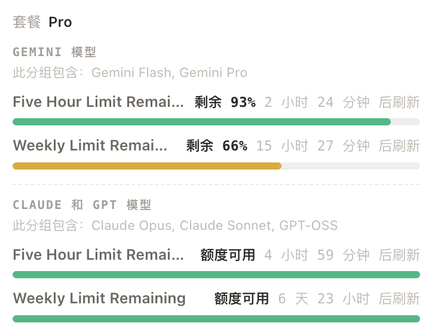

# Antigravity Category Quota Plugin

[CLIProxyAPI (CPA)](https://github.com/router-for-me/CLIProxyAPI) 插件：让管理面板的 Antigravity 账号**同时显示 Gemini 模型和 Claude/GPT 模型的额度**。



## 解决什么问题

官方管理面板查询 Antigravity 额度时，只能看到「Claude 和 GPT 模型」，看不到「Gemini 模型」。

装上插件后：

- **原生管理面板**：额度页直接显示 Gemini 与 Claude/GPT 两组额度（5 小时限额 + 周限额），无需改面板、无需额外操作。
- **插件看板**：侧边栏新增「Antigravity Quota」页面，汇总所有 Antigravity 账号的两组额度和重置时间。

---

## 安装（3 步）

### 1. 下载插件到 CPA 的 `plugins` 目录

先在服务器上运行 `uname -m` 确认架构：`x86_64` 选 amd64，`aarch64` 选 arm64。

**Linux x86_64**（最常见，直接复制执行，只需改第一行）：

```bash
CPA_DIR=/path/to/CLIProxyAPI   # 改成 CPA 所在目录（config.yaml 所在的目录）

mkdir -p "$CPA_DIR/plugins/linux/amd64"
curl -fL -o "$CPA_DIR/plugins/linux/amd64/antigravity-category-plugin-v0.1.0.so" \
  https://github.com/Azurefly/antigravity-category-plugin/releases/download/v0.1.0/antigravity-category-plugin-v0.1.0-linux-amd64.so
```

**其他平台**：从 [Release 页面](https://github.com/Azurefly/antigravity-category-plugin/releases/latest) 下载对应文件，放到下表的目录，**并把文件名改成「保存为」一列的名字**：

| 平台 | 下载文件 | 放到 | 保存为 |
| :--- | :--- | :--- | :--- |
| Linux x86_64 | `…-v0.1.0-linux-amd64.so` | `plugins/linux/amd64/` | `antigravity-category-plugin-v0.1.0.so` |
| Linux ARM64 | `…-v0.1.0-linux-arm64.so` | `plugins/linux/arm64/` | `antigravity-category-plugin-v0.1.0.so` |
| macOS Apple 芯片 | `…-v0.1.0-darwin-arm64.dylib` | `plugins/darwin/arm64/` | `antigravity-category-plugin-v0.1.0.dylib` |
| macOS Intel | `…-v0.1.0-darwin-amd64.dylib` | `plugins/darwin/amd64/` | `antigravity-category-plugin-v0.1.0.dylib` |
| Windows x86_64 | `…-v0.1.0-windows-amd64.dll` | `plugins\windows\amd64\` | `antigravity-category-plugin-v0.1.0.dll` |

> **Docker 部署**：在 `docker-compose.yml` 所在目录操作，把 `CPA_DIR` 设为 `.` 即可（`./plugins` 已挂载进容器）。
> Linux 版要求 glibc 2.31 以上（Debian 11+ / Ubuntu 20.04+ / 官方 Docker 镜像均可），不支持 Alpine。

### 2. 在 `config.yaml` 中开启插件

```yaml
plugins:
  enabled: true
  dir: "plugins"
  configs:
    antigravity-category-plugin:
      enabled: true
```

### 3. 重启 CPA

```bash
systemctl restart cli-proxy-api          # 直接部署（按你的实际服务名）
docker compose restart cli-proxy-api     # Docker 部署
```

重启后等 15 秒，打开管理面板的额度页，就能看到 Gemini 额度。

> 管理面板页面约 3MB，插件更新面板后浏览器需要重新下载一次。服务器带宽较小时首次打开可能要一两分钟，之后会走缓存，打开就快了。

---

## 确认安装成功

- 管理面板侧边栏出现 **「Antigravity Quota」** 菜单，页面里「原生面板修补」显示 **已生效**。
- 管理面板额度页的 Antigravity 账号同时显示 **Gemini 模型** 和 **Claude 和 GPT 模型**。

## 常见问题

| 现象 | 处理 |
| :--- | :--- |
| 没有「Antigravity Quota」菜单 | 检查 `plugins.enabled: true`；检查文件目录和架构是否正确；在 CPA 日志里搜 `pluginhost` 看报错。 |
| 还是看不到 Gemini | 等页面完整加载后再刷新额度；在插件看板查看「修补详情」，如果是「未生效」，通常是 `static/` 目录不可写，可在配置里用 `management_html_path` 指定 `management.html` 的路径。 |
| 插件看板提示输入 Management Key | 在管理面板登录时勾选「记住密码」，或在看板里输入一次（只保存在当前标签页）。 |
| 补丁偶尔消失又恢复 | 正常现象：CPA 每 3 小时会恢复官方面板，插件会在 15 秒内重新打补丁。 |

## 升级与卸载

- **升级**：删除 `plugins` 目录下旧的 `antigravity-category-plugin*` 文件，按「安装」第 1 步下载新版本，重启 CPA。如果 `config.yaml` 里有 `plugins.configs.antigravity-category-plugin.store.version`，把它改成新版本号或删掉。
- **卸载**：在插件看板的「修补详情」中点击「还原原版面板」，然后在 `config.yaml` 里把插件的 `enabled` 改为 `false`，删除插件文件，重启 CPA。

---

## 可选配置

以下配置都有默认值，一般不需要改：

```yaml
plugins:
  configs:
    antigravity-category-plugin:
      enabled: true
      auto_patch_panel: true        # 自动修补原生管理面板（默认开启）
      prefer_prod_endpoint: true    # 优先请求 cloudcode-pa 正式端点
      merge_endpoint_groups: true   # 跨端点合并 Gemini 与 Claude/GPT 分组
      # management_html_path: ""    # 自动找不到 management.html 时手动指定
      # user_agent: ""              # 留空则自动使用最新 Antigravity Hub 版本
```

<details>
<summary><b>工作原理</b>（点击展开）</summary>

**为什么官方面板看不到 Gemini？**

- 面板按 `daily-cloudcode-pa` → sandbox → `cloudcode-pa` 的顺序查询额度，拿到第一个有数据的结果就停止；而 `daily` 端点只返回 Claude/GPT 分组。
- 面板使用的 `antigravity/cli` User-Agent，上游只返回 Claude/GPT 分组；只有 Antigravity Hub 的 User-Agent 在正式端点上才会返回 Gemini 分组。

**插件做了什么？**

1. **修补原生面板**：在 `static/management.html` 注入一段脚本，拦截 Antigravity 额度请求，换成最新 Hub User-Agent，通过面板自己的 `api-call`（与原生请求相同的 CPA 代理和凭证）依次查询 `cloudcode-pa` / `daily-cloudcode-pa` / sandbox，在浏览器里合并两组额度，凑齐即停止；单个端点 20 秒无响应会跳过。文件以原子替换写入，CPA 恢复官方面板后插件会在 15 秒内重新修补。
2. **QuotaProvider**：实现 CPA 的 `quota.fetch` / `quota.describe` 接口，自动刷新 OAuth Token、识别 `project_id` 与订阅等级，并跨端点合并分组。
3. **插件看板**：`/v0/resource/plugins/antigravity-category-plugin/page`，自动沿用面板的 Management Key，打开时显示上次结果，点击「刷新额度」查询全部账号。

</details>

---

## 更新日志

### v0.1.0

- 首个版本：原生管理面板显示 Gemini 与 Claude/GPT 两组额度；提供 QuotaProvider 接口与「Antigravity Quota」插件看板。

## 本地构建

```bash
go test ./...                 # 运行测试
sh scripts/build.sh 0.1.0     # 构建当前平台动态库，输出到 dist/
```
